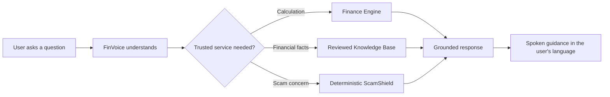
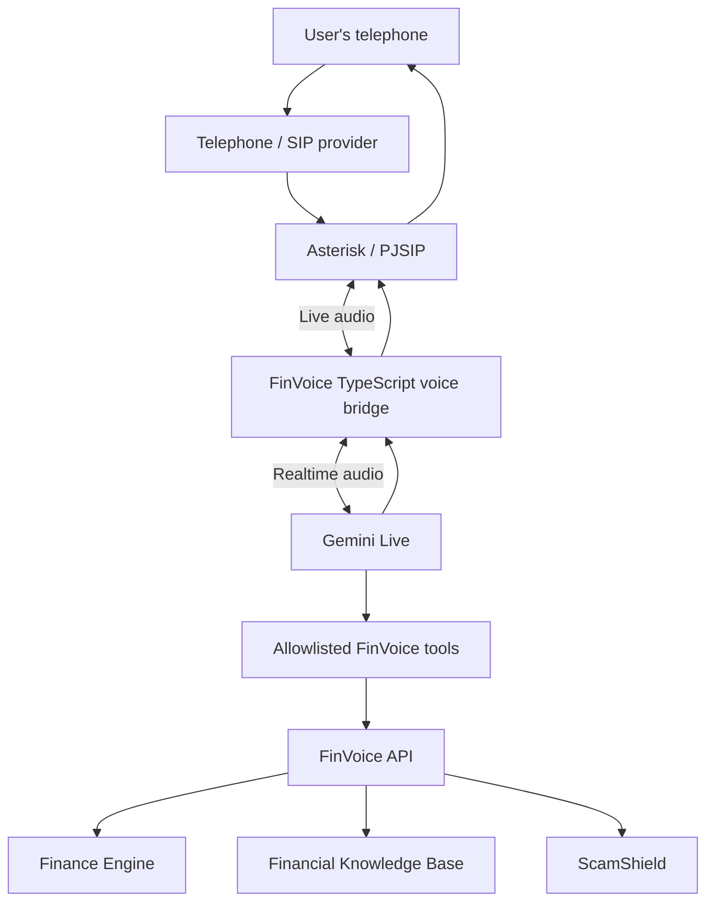
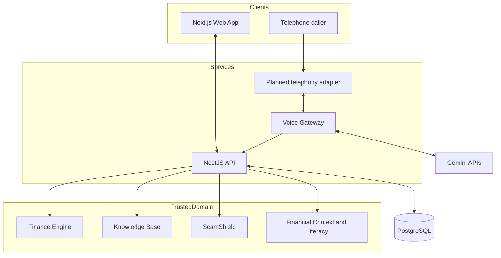

<div align="center">

# FinVoice

**Financial guidance, one conversation at a time.**

A voice-first financial literacy and guidance platform for Sri Lanka, designed to help people understand money, plan their finances, and recognize scams through natural conversations in Sinhala, Tamil, and English.

[](https://nodejs.org/)
[](https://www.typescriptlang.org/)
[](https://nestjs.com/)
[](https://nextjs.org/)
[](https://www.postgresql.org/)
[](https://www.prisma.io/)
[](https://ai.google.dev/)

</div>

---

## Overview

FinVoice is a voice-first financial literacy and guidance system being developed for Sri Lankan users. Its defining experience is **real-time financial guidance through an ordinary telephone call**. A user should be able to call a FinVoice number and speak naturally in Sinhala, Tamil, or English without needing to open a website or install a mobile application.

The web application supports onboarding, financial profiles and goals, dashboards, administration, and browser-based voice interaction. It is a supporting experience; the real-phone experience is the main product.

FinVoice combines conversational AI with trusted backend services to explain financial concepts, help users understand budgets and savings options, calculate loan repayments, and identify warning signs in potentially fraudulent messages.

> **Core principle: AI talks and understands; trusted FinVoice services calculate and validate.**

Gemini provides the conversational interface. The Finance Engine performs calculations, the reviewed knowledge base provides source-backed educational information, and ScamShield applies deterministic risk rules. The model must not replace these trusted components with invented figures or unsupported claims.

## Table of contents

- [Why FinVoice?](#why-finvoice)
- [Feature highlights](#feature-highlights)
- [Telephone-call experience](#telephone-call-experience)
- [Architecture](#architecture)
- [Technology stack](#technology-stack)
- [Repository structure](#repository-structure)
- [Getting started](#getting-started)
- [Configuration](#configuration)
- [Database setup](#database-setup)
- [Running the project](#running-the-project)
- [API overview](#api-overview)
- [Testing](#testing)
- [Security and privacy](#security-and-privacy)
- [Project status](#project-status)
- [Roadmap](#roadmap)

## Why FinVoice?

Financial information can be difficult to understand, and digital services can be hard to use for people who are less comfortable with apps, websites, or typing. FinVoice aims to make financial literacy more accessible through spoken conversations, supported by a web interface and trusted financial services.



## Feature highlights

### ☎️ Phone-first AI assistant

- Intended access through a normal telephone call.
- Natural spoken conversations.
- Sinhala, Tamil, and English as target languages.
- Real-time responses using Gemini Live.
- Call interruptions, timeouts, disconnects, and resource cleanup are core requirements.

**Status:** Real telephone/SIP integration is planned and has not yet been verified as implemented.

### 🗣️ Browser voice experience

- Browser-to-WebSocket audio streaming.
- AudioWorklet-based capture and playback.
- Streaming speech output and interruption support.
- Gemini Live session handling.
- Useful for development and browser-based access.

**Status:** Implemented in the existing voice gateway; continue to validate behavior and multilingual quality.

### 💰 Financial calculation engine

- Reducing-balance loan repayment estimates.
- Savings planning.
- Budget summaries.
- Decimal-safe money calculations.
- Versioned calculation behavior.

The backend calculation engine—not the language model—is authoritative for calculated values.

### 📚 Financial knowledge base

- Saving and budgeting.
- Borrowing and loan terminology.
- Digital finance and payment safety.
- Consumer protection and scam awareness.
- Deposit protection and general financial literacy.
- Sinhala, Tamil, and English article translations.
- Source attribution and review metadata.

### 🛡️ ScamShield

- Deterministic rules for suspicious-message indicators.
- Risk classifications: `HIGH`, `MEDIUM`, `LOW`, or `INSUFFICIENT_INFORMATION`.
- Evidence-based explanations and safe next steps.
- Sensitive card-like number masking.
- No guarantee that a message is safe merely because no indicator was detected.

### 👤 Profiles and financial goals

- Phone-based OTP authentication.
- User profile and preferred language.
- Monthly income and expense profile.
- Savings, emergency fund, and debt-repayment goals.
- Goal progress and protected user-specific APIs.

A real production SMS provider is still required before public OTP sign-in is production-ready.

### 📊 Analytics and administration

- Privacy-conscious typed analytics events.
- Aggregated usage and operational views.
- Knowledge-base review information.
- Protected admin endpoints and dashboard.
- Retention and cleanup processes.

### 🔐 Security and privacy

- Protected internal APIs.
- Role and ownership checks.
- Hashed OTP challenges and refresh tokens.
- Server-side AI credentials.
- No raw call recording or transcript persistence by default.
- Financial and scam logic separated from AI-generated language.

## Telephone-call experience

The target phone experience is:

1. A user calls a configured FinVoice telephone number.
2. A compatible telephony provider routes the call to the telephony system.
3. Asterisk/PJSIP manages the call.
4. AudioSocket (or another evaluated transport) connects the call to a TypeScript voice bridge.
5. The bridge streams audio to the existing Gemini Live integration.
6. Gemini uses trusted FinVoice tools when calculations, knowledge lookup, user context, or scam analysis are needed.
7. Spoken responses return to the caller.
8. The call ends cleanly, with bounded resource usage and safe error handling.



The proposed telephony design is informed by a separate reference project. It must be validated against FinVoice's current gateway before implementation. **The existence of browser voice does not mean real telephone calls are already supported.**

## Architecture

FinVoice is organized as a TypeScript monorepo. The web application, API, and voice gateway have separate responsibilities while sharing typed contracts and trusted domain packages.



### Main components

| Component | Responsibility |
|---|---|
| `apps/web` | Next.js web interface, authentication, onboarding, goals, and browser experience |
| `apps/api` | NestJS REST APIs, authentication, user domain, trusted tools, knowledge, calculations, analytics |
| `apps/voice-gateway` | Realtime voice sessions and Gemini Live integration; planned phone-audio adapter |
| `packages/finance-engine` | Framework-independent deterministic financial calculations |
| `packages/contracts` | Shared API contracts and validation schemas |
| `packages/shared` | Shared types and utilities |
| `packages/config` | Shared configuration and project conventions |
| PostgreSQL + Prisma | Persistent domain data, knowledge content, authentication state, and analytics |

The exact directory and package names should be confirmed against the current repository before making code changes.

## Technology stack

### Backend and shared packages

- Node.js 24 LTS
- TypeScript and pnpm workspaces
- NestJS
- PostgreSQL 18 and Prisma ORM
- Decimal.js for deterministic money calculations
- Vitest and automated CI checks

### Web and voice

- Next.js and React
- WebSocket-based browser voice transport
- AudioWorklet for browser audio
- Google Gemini Interactions API for the text agent
- Google Gemini Live API for realtime voice

### Planned telephony layer

- A compatible telephone/SIP provider
- Asterisk with PJSIP
- AudioSocket or another validated audio transport
- TypeScript bridge integrated with the existing voice gateway

Telephony provider availability, pricing, SIP credentials, and production connectivity have not yet been verified.

## Repository structure

This is the current monorepo layout for the project.

```text
FinVoice/
├── .github/
│   └── workflows/
├── apps/
│   ├── api/                  # NestJS REST API and domain services
│   ├── web/                  # Next.js web app and browser experience
│   └── voice-gateway/        # Realtime voice gateway / Gemini integration
├── docs/
│   ├── api/
│   ├── architecture/
│   └── decisions/
├── infrastructure/
│   ├── docker/
│   └── postgres/
├── packages/
│   ├── config/              # Shared config and conventions
│   ├── contracts/            # Shared contracts and validation schemas
│   ├── finance-engine/       # Deterministic financial calculations
│   ├── scam-shield/          # Scam detection and risk classification logic
│   └── shared/               # Shared utilities and types
├── .editorconfig
├── .env
├── .env.example
├── .gitattributes
├── .gitignore
├── .nvmrc
├── .prettierignore
├── .prettierrc.json
├── docker-compose.yml
├── eslint.config.js
├── package.json
├── pnpm-lock.yaml
├── pnpm-workspace.yaml
├── README.md
└── tsconfig.base.json
```

## Getting started

### Prerequisites

| Requirement | Purpose |
|---|---|
| Node.js 24 | API, web, voice gateway, and tooling |
| pnpm | Monorepo package management |
| Docker Desktop | Local PostgreSQL service |
| Git | Version control |
| Gemini API credentials | AI agent and voice functionality |
| SIP/telephony credentials | Required only when testing real phone calls |

Use the repository's `.nvmrc` and package-manager configuration where available. Confirm versions from the repository before installing or upgrading tools.

## Configuration

1. Review `.env.example`.
2. Configure local environment values using your own credentials.
3. Keep secrets out of source control and frontend bundles.
4. Never paste secrets into logs, screenshots, prompts, or documentation.

Configuration categories may include PostgreSQL, Gemini, internal API/voice-gateway authentication, OTP/session settings, admin access, and optional telephony/SIP/Asterisk settings. Use the exact variable names defined by `.env.example` and the configuration code; do not assume names from this README.

> **Never commit real credentials.** Keep API keys server-side. Use development-only credentials locally and rotate any secret that may have been exposed.

## Database setup

FinVoice uses PostgreSQL and Prisma migrations.

The local Docker PostgreSQL service uses host port **5433** because another local PostgreSQL installation uses port 5432. Preserve this mapping unless the project owner explicitly approves a change.

From the repository root, the currently reported scripts include:

```bash
pnpm db:up
pnpm db:migrate:status
```

After checking migration status and the current scripts, local migrations can be applied with:

```bash
pnpm db:migrate
```

Use fake/development data locally. Review migrations and back up persistent data before applying schema changes to a shared or production database.

## Running the project

Run commands from the repository root unless noted otherwise. Confirm script names in `package.json` before running them.

### 1. Start PostgreSQL

```bash
pnpm db:up
```

### 2. Start the API

In a separate terminal:

```bash
pnpm dev:api
```

A previously used local readiness endpoint is:

```text
http://127.0.0.1:4000/health/ready
```

Confirm the configured port and health route from the current code.

### 3. Start the web application

```bash
pnpm dev:web
```

Open the URL printed by Next.js, commonly `http://localhost:3000`.

### 4. Start the voice gateway when needed

```bash
pnpm dev:voice-gateway
```

The voice gateway requires the configured API and Gemini credentials. Browser voice testing is separate from real telephone-call testing.

### 5. Start all development services

```bash
pnpm dev
```

Use this only after confirming local configuration and required services are ready. Do not start paid telephony services or place external calls without explicit approval.

## API overview

The current API includes authentication and current-user profile, financial profiles and goals, loan/savings/budget calculations, financial knowledge, text-agent conversations, internal context/tool access, ScamShield, analytics, and protected administration.

Representative routes reported as implemented include:

```text
POST   /api/v1/auth/request-otp
POST   /api/v1/auth/verify-otp
POST   /api/v1/auth/refresh
POST   /api/v1/auth/logout
GET    /api/v1/auth/me

POST   /api/v1/agent/chat

POST   /api/v1/calculations/loan
POST   /api/v1/calculations/savings
POST   /api/v1/calculations/budget
```

Authenticated `/me` routes include profile, financial-profile, and goal operations. Verify route definitions and API documentation in the current source before relying on this list.

## Testing

Use the scripts defined by the repository. The following commands have been reported as available:

```bash
pnpm test
pnpm test:integration
pnpm test:e2e
pnpm typecheck
pnpm lint
pnpm build
pnpm format:check
```

Run targeted tests during development, then relevant full checks before completing a change. Report exact commands and results. Never claim a test passed unless it was actually run.

### Additional phone-integration tests required

- Inbound call connects to the intended FinVoice session.
- Caller speech reaches Gemini and spoken response returns to the phone.
- Correct audio framing and sample-rate conversion.
- Silence, interruption/barge-in, and long turns.
- Clean hang-up and resource cleanup.
- SIP, AudioSocket, Gemini, and backend timeouts/failures.
- Concurrent calls, usage limits, and cost controls.
- Sinhala, Tamil, and English real-call acceptance tests.
- No unintended audio/transcript persistence or sensitive logging.

## Security and privacy

- Never request banking PINs, OTPs, passwords, full card details, or online-banking credentials.
- Treat caller ID as unverified identity unless a separate trusted process verifies it.
- Do not record calls or persist transcripts by default.
- Keep API keys and internal tokens server-side.
- Bound tool calls, session length, concurrent calls, payloads, retries, and cost.
- Use reviewed sources for financial facts and show assumptions for calculations.
- A missing ScamShield indicator is not proof that a message is safe.
- Review applicable Sri Lankan data-protection, privacy, and telephony obligations before public launch.

---

<div align="center">

**FinVoice — Financial guidance, one conversation at a time.**

</div>
